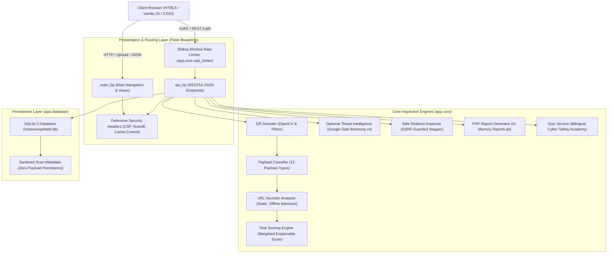
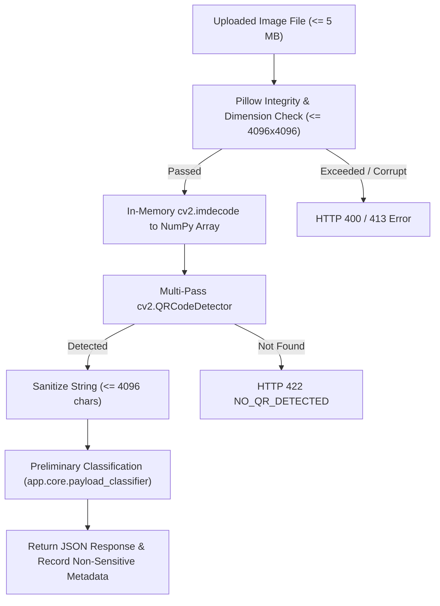

# QShield System Architecture & Technical Design

**Project:** QShield — QR Phishing Detection & Awareness System  
**Tagline:** “Decode the QR. Detect the Threat.”

---

## 1. High-Level Component Architecture

QShield is structured as a modular, privacy-preserving defensive cybersecurity application using a layered Flask architecture:



---

## 2. Core Request & Processing Workflows

### A. QR Code Upload & Optical Decoding Pipeline
When an image is submitted to `/api/decode-qr`:
1. **Request Bound Check:** Enforces 5 MB limit (`MAX_CONTENT_LENGTH`) on the stream.
2. **In-Memory Image Validation:** Pillow verifies file magic bytes (`PNG`, `JPEG`, `WEBP`, `BMP`) and checks dimensions (`<= 4096×4096 px`, `<= 16 MP`) to prevent decompression bombs.
3. **OpenCV Matrix Parsing:** Decodes bytes in RAM into a NumPy array (`cv2.imdecode`). Never writes temporary image files to disk.
4. **Multi-Pass Detection:** `cv2.QRCodeDetector()` executes on standard RGB -> enhanced contrast grayscale -> adaptive thresholding.
5. **String Sanitization:** Truncates string to a safe maximum of 4096 characters to prevent memory exhaustion.



---

### B. Static Heuristic URL Analysis & Risk Scoring
When a decoded link or manual URL is analyzed at `/api/analyze-url`:
1. **Safe URL Parsing:** Parses string using `urllib.parse.urlsplit` without opening network connections.
2. **Protocol Allowlist:** Allows only `http` and `https`. Rejects `javascript:`, `data:`, `vbscript:`, `file:`.
3. **Offline Registered Domain Extraction:** Uses `tldextract` with cache and suffix downloading disabled (`TLDExtract(suffix_list_urls=None, cache_dir=None)`).
4. **12 Heuristic Evaluators:** Evaluates userinfo deception (`@`), IP hostnames, Punycode/IDN, brand impersonation in subdomains, credential keywords, urgency tokens, length, unusual ports, shorteners, and query parameter counts.
5. **Weighted Score Calculation:** Aggregates findings (0–100 score), applies family discounts for correlated indicators, clamps to bounds, and assigns a risk tier (`Low`, `Medium`, `High`, `Critical`).
6. **Privacy-Preserving Record:** Strips path, query, and userinfo, storing only the sanitized hostname in SQLite history.

---

### C. SSRF-Guarded Redirect Inspection Pipeline
When a user explicitly opts in to trace redirects at `/api/inspect-redirects`:
1. **Consent Verification:** Rejects request if `user_consent != true`.
2. **Destination Safety Check:** Resolves destination hostname via `socket.getaddrinfo`.
   - Rejects loopback (`127.0.0.0/8`, `::1`).
   - Rejects RFC1918 private subnets (`10.0.0.0/8`, `172.16.0.0/12`, `192.168.0.0/16`).
   - Rejects cloud metadata addresses (`169.254.169.254`, `169.254.170.2`, `fd00:ec2::254`, `metadata.google.internal`).
   - Rejects dual-homed DNS answers where any resolved IP is internal.
3. **Manual Single-Hop HTTP Request:** Disables automatic client redirects. Sends minimal `HEAD` request (fallback to 4 KB bounded `GET`).
4. **Loop & Downgrade Detection:** Tracks visited URLs to detect loops; flags HTTPS -> HTTP scheme downgrades and cross-domain hops.
5. **Bounded Execution:** Halts after at most 5 hops or upon encountering any unsafe destination.

---

## 3. Trust Boundaries & Defensive Controls

| Boundary | Interacting Parties | Security & Privacy Protections Enforced |
| :--- | :--- | :--- |
| **Client to Server** | Browser to Flask Endpoints | REST input validation, 5 MB payload limit, sliding window rate limiting (HTTP 429), CSP (`frame-ancestors 'none'`), Referrer-Policy, nosniff, uniform JSON errors without stack traces. |
| **Server to Storage** | Application to SQLite | Parameterized SQL (`?`), strict integer pagination bounds, context teardown closing (`close_db`), zero-payload storage policy. |
| **Server to Network** | Redirect Inspector & Safe Browsing | Zero-outbound default for regular scanning; mandatory user consent for external calls; comprehensive SSRF destination filtering; sensitive URL token skipping; strict timeouts. |
| **Server to Admin** | Admin Dashboard to Telemetry | Constant-time token verification (`hmac.compare_digest`), production lockdown if key is unconfigured, zero secret leakage in health responses. |
| **Server to PDF** | ReportLab Document Engine | In-memory generation (`io.BytesIO`), XML entity escaping, non-printable control character filtering (`\x00-\x1f`), sensitive URL parameter redaction (`mask_sensitive_url`). |

---

## 4. Privacy-by-Design Architecture

QShield intentionally minimizes data persistence:
- **No Payload Store:** Decoded QR text and uploaded image bytes exist only in RAM during request processing and are discarded upon response completion.
- **Credential Masking:** Wi-Fi passwords, UPI transaction secrets, and authentication parameters are masked with bullet characters (`••••••••`) or `[REDACTED]` prior to UI rendering or reporting.
- **Sanitized Audit History:** SQLite stores only coarse operational metadata:
  ```sql
  INSERT INTO scan_history (scan_type, payload_type, target_domain, risk_score, risk_level, indicator_count, status, created_at)
  VALUES (?, ?, ?, ?, ?, ?, ?, ?)
  ```
