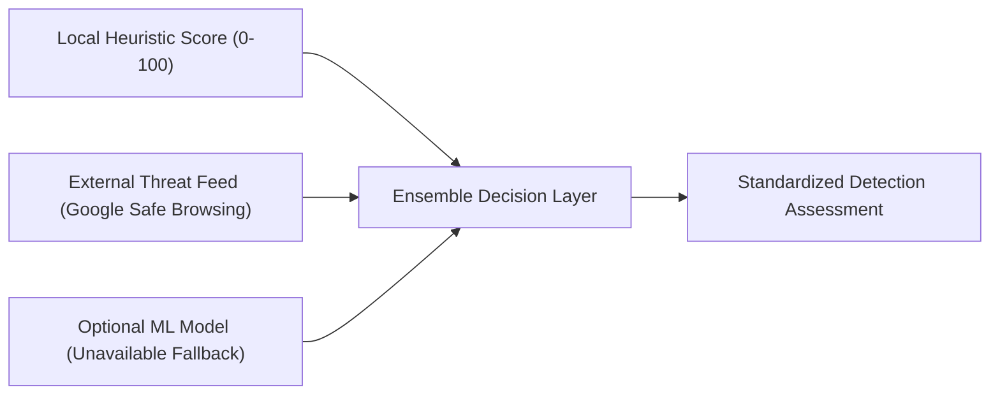

# QShield Detection Methodology & Heuristic Feature Specifications

**Project:** QShield — QR Phishing Detection & Awareness System  
**Tagline:** “Decode the QR. Detect the Threat.”

---

## 1. Detection Principles & Philosophy

QShield's detection methodology is founded on five core engineering principles:
1. **Zero-Outbound Default:** Feature extraction and heuristic risk scoring execute entirely in-process using local algorithms. No DNS lookups, external socket connections, or third-party API queries are conducted for ordinary scanning.
2. **Deterministic & Explainable:** Every risk point added to the score must map directly to an observable, documented lexical or structural pattern.
3. **No False Equivalence:** A heuristic risk score is an indicator of evasion techniques, **not** an empirical mathematical probability of phishing.
4. **Anti-Inflation Correlated Discounting:** Multiple related findings within the same semantic family are discounted by 50% to prevent artificial score ballooning.
5. **Separation of Evidence Sources:** Locally inferred structural risks and third-party reputation hits are reported under distinct keys and never merged into an unqualified claim of "confirmed phishing".

---

## 2. Advanced Feature Extraction Specification (21 Features)

The feature extractor (`app/core/feature_extractor.py`) parses URLs into 21 structural and statistical dimensions:

| Feature Key | Type | Description | Defensive Significance |
| :--- | :---: | :--- | :--- |
| `f_url_len` | `float` | Total URL character length | Phishing lures often exceed 250 characters to push the real domain off mobile screens. |
| `f_host_len` | `float` | Destination hostname length | Obfuscated hostnames often string together multiple subdomains or keywords. |
| `f_path_len` | `float` | Path component length | Complex nested directories concealing credential harvesting endpoints. |
| `f_query_len` | `float` | Query string character length | Deep query payloads concealing base64-encoded redirect targets or session IDs. |
| `f_subdomain_depth` | `float` | Count of dot-separated subdomain labels | Normal domains have 0 or 1 subdomain (e.g. `www`, `blog`). Phishing kits frequently use $\ge 3$. |
| `f_hyphen_count` | `float` | Number of hyphens (`-`) in hostname | Hyphens are widely used in typosquatting and mimicry (e.g. `paypal-security-update.com`). |
| `f_digit_ratio` | `float` | Ratio of digits to total hostname characters | High digit density ($\ge 0.25$) is characteristic of bot-generated domains (DGA). |
| `f_percent_count` | `float` | Number of percent-encoded triplets (`%20`) | Excessive encoding masks directory traversal and deceptive characters. |
| `f_path_entropy` | `float` | Shannon entropy of URL path ($H$) | $H \ge 4.2$ bits/char indicates randomized hashing or packed payloads. |
| `f_query_entropy` | `float` | Shannon entropy of URL query ($H$) | High entropy signals encoded base64 blobs or cryptographic challenge tokens. |
| `f_is_https` | `binary` | 1.0 if HTTPS; 0.0 if plain HTTP | Plain HTTP exposes all transit data in cleartext across public networks. |
| `f_is_ip_host` | `binary` | 1.0 if host is IPv4/IPv6 literal | Legitimate consumer services virtually never use raw numerical IPs for public portals. |
| `f_is_punycode` | `binary` | 1.0 if host contains `xn--` (IDN) | Internationalized homoglyphs (Cyrillic `а` vs Latin `a`) deceive users visually. |
| `f_has_userinfo` | `binary` | 1.0 if `@` character is in authority | Deceptive browser syntax: `https://google.com@evil.com` resolves to `evil.com`. |
| `f_is_shortener` | `binary` | 1.0 if domain matches shortener index | Shortened URLs conceal the true destination until the link is opened. |
| `f_has_redirect_param`| `binary` | 1.0 if query contains redirect parameter | Keys like `url=`, `redirect=`, `dest=` indicate open redirection vulnerabilities. |
| `f_has_non_standard_port`| `binary`| 1.0 if port $\notin \{80, 443, 8080, 8443\}$ | Unusual ports often host ad-hoc phishing kits or rogue proxy listeners. |
| `f_brand_mimicry` | `binary` | 1.0 if brand token appears outside official domain | Detects `paypal.com.verify.xyz` or `chase-security.net`. |
| `f_cred_keywords` | `float` | Count of matched credential keywords | Terms like `login`, `signin`, `verify`, `password`, `wallet` in path/query. |
| `f_urgency_keywords` | `float` | Count of matched urgency keywords | Terms like `urgent`, `suspended`, `action-required`, `locked`. |
| `f_query_param_count` | `float` | Total number of query parameters | High parameter counts ($\ge 8$) indicate tracking beacons or complex redirect chains. |

---

## 3. Shannon Entropy Formulation

Entropy measures the average information density and randomness of characters in a string:

$$H(X) = -\sum_{i=1}^{n} P(x_i) \log_2 P(x_i)$$

Where:
- $n$ is the number of unique characters in the string.
- $P(x_i) = \frac{\text{count}(x_i)}{\text{total length}}$.

**Thresholds:**
- **Standard English Text / Predictable Paths:** $H \approx 2.5 - 3.8\text{ bits/char}$.
- **Randomized Tokens / Encrypted Blobs:** $H \ge 4.2\text{ bits/char}$. When detected in the query string, QShield flags `URL_HIGH_ENTROPY_QUERY`.

---

## 4. Brand Mimicry & Subdomain Deception Algorithm

The brand impersonation detector cross-references hostnames against a configurable dictionary of high-value brands:

$$\text{TARGET\_BRANDS} = \{\text{'google'}: \text{'google.com'}, \text{'paypal'}: \text{'paypal.com'}, \dots\}$$

**Evaluation Algorithm:**
1. Extract `registered_domain` and `subdomain` using offline `tldextract`.
2. For each configured `brand`:
   - If `brand` appears in `hostname` **AND** `registered_domain` $\ne$ `canonical_domain`:
     - If `brand` $\in$ `subdomain`: Trigger `URL_BRAND_IN_SUBDOMAIN` (Severity: High, Base: +25 pts).
     - If `brand` $\in$ `registered_domain`: Trigger `URL_BRAND_TYPOSQUAT_SUSPICION` (Severity: Medium, Base: +15 pts).

---

## 5. Correlated Indicator Grouping & Family Discounting

To prevent score inflation from redundant symptoms of the same evasion technique:

| Indicator Family | Grouped Indicator Identifiers | Primary Weight | Secondary Weight |
| :--- | :--- | :---: | :---: |
| **Brand Mimicry** | `URL_BRAND_IN_SUBDOMAIN`, `URL_BRAND_TYPOSQUAT_SUSPICION` | 100% | 50% discount |
| **Credential Context**| `URL_CREDENTIAL_KEYWORDS_IN_PATH`, `URL_URGENCY_KEYWORDS_IN_PATH` | 100% | 50% discount |
| **Length Obfuscation**| `URL_EXCESSIVE_LENGTH`, `URL_EXCESSIVE_QUERY_PARAMS` | 100% | 50% discount |

---

## 6. Ensemble Decision Logic

The modular detection engine coordinates three evidence streams:

1. **If Threat Feed returns `malicious`:**  
   Overall risk level elevates to `critical` and score is clamped to at least 85. Evidence source is labeled `heuristic_plus_threat_feed`.
2. **If Threat Feed is clean / not found:**  
   Local heuristic score is preserved. A clean external reputation **never** reduces a locally detected high-risk structural score.
3. **If ML Model is active:**  
   Model confidence contributes statistical weighting. If model is unavailable, engine reports `analysis_method: "heuristic_rules"` without fabricating predictions.
